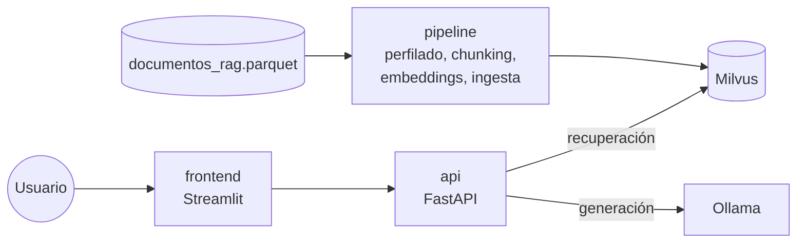

# Asistente RAG con Milvus y LLM locales

Asistente de preguntas y respuestas con generación aumentada por recuperación (RAG) sobre un corpus de prensa digital y publicaciones de Bluesky. Los fragmentos relevantes se recuperan en Milvus y la respuesta la genera un LLM local servido por Ollama, al que se le pide citar la evidencia que usa. Todo corre en Docker Compose, sin APIs de pago.

Proyecto académico de la Maestría en Inteligencia Artificial, Pontificia Universidad Javeriana.

## El taller

El proyecto responde al *Taller de investigación aplicada: Sistemas RAG con Milvus y LLM locales* (octubre de 2026). El reto es diseñar, implementar, desplegar y evaluar de forma reproducible un asistente RAG sobre un corpus real, sin servicios de pago ni dependencias obligatorias de APIs comerciales.

**Pregunta de investigación:** ¿qué LLM local pequeño ofrece el mejor equilibrio entre exactitud factual, fidelidad a las fuentes, abstención apropiada, latencia y recursos en este corpus?

El experimento principal cambia solo el LLM. Todo lo demás queda fijo: corpus, muestra, chunks, encoder, colección de Milvus, índice, `k`, contexto recuperado y prompt. Las ablaciones varían una sola dimensión a la vez (`k`, segmentación, encoder o estrategia de contexto).

**Requisitos del enunciado:**

- un único `docker-compose.yml` en la raíz, con Dockerfiles, `.env.example`, volúmenes y README;
- Milvus standalone como único motor de recuperación vectorial (etcd y MinIO son su infraestructura, no motores alternativos);
- un encoder abierto y local, y FastAPI con `/health`, `/retrieve` y `/ask`;
- una interfaz web para elegir el modelo, preguntar, ajustar `k` y examinar las fuentes;
- al menos tres LLM locales pequeños servidos con Ollama;
- un gold estándar de al menos 40 preguntas, con conjuntos de desarrollo y de prueba.

### Fases y estado

| Fase | Qué pide el enunciado | Estado | Resultados |
|---|---|---|---|
| 0. Fundaciones | Infraestructura en Docker y descarga verificada del corpus | Terminada | este README |
| A. Exploración y calidad | Fuentes, longitudes, idiomas, duplicados, fechas, sesgos y muestras reproducibles | Terminada | [`reports/eda/resumen.md`](reports/eda/resumen.md) |
| B. Segmentación | Dos estrategias de chunking con tokens, solapamiento, offsets, IDs estables y deduplicación trazable | Terminada | [`reports/chunking/resumen.md`](reports/chunking/resumen.md) |
| C. Embeddings | Encoder multilingüe justificado, vecinos semánticos y sensibilidad | Terminada | [`reports/embeddings/resumen.md`](reports/embeddings/resumen.md) |
| D. Milvus | Colección, campos, índice, filtros, reindexación idempotente, conteos y persistencia | Terminada | [`reports/milvus/resumen.md`](reports/milvus/resumen.md) |
| E. Orquestación RAG | Recuperar y generar por separado, prompts versionados, presupuesto de contexto, citas y abstención | Pendiente | |
| F. API e interfaz | Respuesta, tiempos, evidencias y enlaces; errores, estados de carga y modelo elegido en vivo | Parcial: API e interfaz base | `app/` |
| G. Operación | Instrucciones desde cero, modelos, pruebas, persistencia, logs y límites de recursos | Parcial | este README |
| Gold estándar | 40 preguntas o más: ambas colecciones, varios idiomas y fechas, `dev` y `test` | Borrador con 52 preguntas | [`data/gold/README.md`](data/gold/README.md) |
| Evaluación | 3 LLM o más, ablaciones y métricas de recuperación, generación, rendimiento y robustez | Pendiente | [`docs/EVALUACION.md`](docs/EVALUACION.md) |

Las decisiones de diseño de todas las fases, con sus alternativas y evidencia, están en [`docs/decisiones.md`](docs/decisiones.md).

## Arquitectura



| Servicio | Rol | Puerto local |
|---|---|---|
| `milvus` | Base de datos vectorial (standalone). WebUI en `/webui` | 19530, 9091 |
| `etcd`, `minio` | Metadatos y almacenamiento de objetos de Milvus. Consola de MinIO en 9001 | 9001 |
| `attu` | Interfaz para inspeccionar colecciones de Milvus | 3000 |
| `ollama` | LLM locales | 11434 |
| `api` | FastAPI: recuperación y generación | 8000 |
| `frontend` | Interfaz Streamlit | 8501 |
| `pipeline` | Trabajos batch (descarga, perfilado, segmentación, vectores, ingesta, reportes y pruebas). Perfil `tools`: no arranca con `up` | — |

`docker-compose.yml` solo incluye los archivos de `docker/`, uno por conjunto de servicios: `milvus.yml` (milvus, etcd, minio, attu), `ollama.yml`, `api.yml`, `frontend.yml` y `pipeline.yml`. Cada servicio propio tiene su Dockerfile en `docker/` y su lista de dependencias en `requirements/`.

El encoder se carga desde un único módulo, `app/embeddings.py`, que usan tanto `api` como `pipeline`. Ambos servicios comparten el volumen `hf_cache` con los pesos del modelo, así que las consultas y los pasajes se codifican exactamente igual.

- **Encoder:** `ibm-granite/granite-embedding-97m-multilingual-r2` (384 dimensiones, sin prefijos, coseno). La API lo toma de `.env` y el pipeline de `configs/encoders.yaml`, con la misma revisión fijada.
- **Segmentación:** mide siempre el tamaño de los chunks con el tokenizador de e5-small, para que los chunks no cambien aunque cambie el encoder.
- **Índice:** HNSW (M = 16, efConstruction = 200, COSINE), con `ef = 64` calibrado frente a la búsqueda exacta. Las colecciones las crea solo la ingesta; la API solo busca.

## Requisitos

- Docker Engine con Compose 2.20 o superior (por `include`).
- RAM: se recomiendan 16 GB para la pila completa. Depende del LLM elegido. Las cifras de este repositorio se midieron con 10 CPU y 8 GB asignados a Docker.
- Disco: conviene tener unos 25 GB libres. En macOS con Apple Silicon y `qwen2.5:1.5b` se midieron 17,3 GB de imágenes y 4,3 GB de volúmenes (modelos y Milvus), más la caché de build.

## Puesta en marcha

```bash
cp .env.example .env
docker compose up -d --build

# Corpus: descarga, verifica el sha256 y no sobrescribe sin --force
docker compose --profile tools run --rm pipeline python -m scripts.download_corpus

# Perfilado, muestras, chunks y vectores de la muestra de 10.000 (estrategia B; la vectorización tarda unos 35 min)
docker compose --profile tools run --rm pipeline python -m scripts.profile_corpus
docker compose --profile tools run --rm pipeline python -m scripts.build_chunks --strategy B --sample data/samples/sample_10000_ids.txt
docker compose --profile tools run --rm pipeline python -m scripts.embed_chunks --encoder granite-97m --strategy B --sample sample_10000

# Carga en Milvus de la colección que usa la API
docker compose --profile tools run --rm pipeline python -m scripts.ingest --collection sent256_s10k

# LLM por defecto
docker compose exec ollama ollama pull qwen2.5:1.5b
```

Las demás colecciones (piloto de 2.000, estrategia A y la adversarial) se cargan igual con su clave. El orden completo está en [Reproducir los resultados desde cero](#reproducir-los-resultados-desde-cero).

Después:

- Interfaz: http://localhost:8501
- Documentación de la API: http://localhost:8000/docs
- Attu: http://localhost:3000. Conectar a `milvus:19530`, sin usuario ni contraseña.
- WebUI de Milvus: http://localhost:9091/webui/

## Uso

### Interfaz

1. Abrir http://localhost:8501.
2. Elegir el LLM. Tiene que estar descargado en Ollama (ver [Modelos LLM](#modelos-llm)).
3. Ajustar `Top-k`, el número de fragmentos que se recuperan (de 1 a 15).
4. Escribir la pregunta y pulsar **Consultar**.

La interfaz muestra la respuesta, el modelo, la latencia total y cada evidencia con su `document_id`, su score, el texto del fragmento y el enlace a la fuente. Las respuestas siempre deben contrastarse con las fuentes.

### API

| Método | Ruta | Descripción |
|---|---|---|
| `GET` | `/health` | Disponibilidad de la API (no comprueba Milvus ni Ollama) |
| `POST` | `/retrieve` | Fragmentos recuperados con su score y metadatos |
| `POST` | `/ask` | Respuesta del LLM, modelo, evidencia y latencia |

```bash
curl -s localhost:8000/health
curl -s -X POST localhost:8000/retrieve -H 'Content-Type: application/json' \
  -d '{"query": "¿Qué se acordó en la plenaria de la COP16?", "k": 5}'
curl -s -X POST localhost:8000/ask -H 'Content-Type: application/json' \
  -d '{"query": "¿Qué se acordó en la plenaria de la COP16?", "model": "qwen2.5:1.5b", "k": 5, "temperature": 0.0}'
```

`query` necesita al menos 3 caracteres, `k` va de 1 a 15 y `temperature` de 0 a 1. `/retrieve` ignora `model` y `temperature`.

Cada fragmento de la evidencia trae:

- `chunk_id` y `score` (similitud coseno);
- `document_id`, `chunk_index`, y `char_start` y `char_end` (offsets en caracteres sobre el texto original);
- `text`, `title` y `url`;
- `collection_name`, `source` y `language`;
- `created_at` (segundos UTC, o `null`);
- `provenance_ids`: todos los documentos que contienen ese mismo texto.

### Colecciones

La API busca en la colección de `MILVUS_COLLECTION`. Las cinco colecciones se definen en `configs/milvus.yaml` y se cargan con `scripts.ingest --collection <clave>`:

| Clave | Colección | Contenido |
|---|---|---|
| `sent256_s10k` | `rag_granite97m_sent256_s10k_v1` | Estrategia B, muestra de 10.000 (37.919 chunks). La usa la API por defecto |
| `win256_s10k` | `rag_granite97m_win256_s10k_v1` | Estrategia A, muestra de 10.000 (33.431 chunks) |
| `sent256_s2k` | `rag_granite97m_sent256_s2k_v1` | Estrategia B, piloto de 2.000 (7.517 chunks) |
| `win256_s2k` | `rag_granite97m_win256_s2k_v1` | Estrategia A, piloto de 2.000 (6.659 chunks) |
| `sent256_adv` | `rag_granite97m_sent256_adv_v1` | Prueba adversarial (36 chunks): documentos de Q45-Q48 y 4 documentos sintéticos con inyección de prompt |

Para que la API use otra colección, se cambia `MILVUS_COLLECTION` en `.env` y se recrea el servicio:

```bash
docker compose up -d --force-recreate api
```

La colección adversarial contiene instrucciones maliciosas a propósito, así que no se debe usar como colección por defecto.

## Configuración

Las variables se leen de `.env` (plantilla en `.env.example`):

| Variable | Uso |
|---|---|
| `MILVUS_URI` | Dirección de Milvus |
| `MILVUS_COLLECTION` | Colección en la que busca la API. El nombre identifica encoder, segmentación, muestra y versión, p. ej. `rag_granite97m_sent256_s10k_v1` |
| `MILVUS_SEARCH_EF` | Amplitud de búsqueda del índice HNSW (64, calibrada en `reports/milvus/`) |
| `EMBEDDING_MODEL` | Modelo de Sentence Transformers |
| `EMBEDDING_REVISION` | Revisión (commit) fija del modelo en Hugging Face |
| `EMBEDDING_QUERY_PREFIX`, `EMBEDDING_PASSAGE_PREFIX` | Prefijos de consulta y pasaje. Vacíos para granite; con E5 serían `"query: "` y `"passage: "`. Van entre comillas para conservar el espacio final |
| `EMBEDDING_NORMALIZE` | Normalización L2 de los vectores (`true` o `false`) |
| `OLLAMA_URL` | Dirección de Ollama |
| `MAX_CONTEXT_CHARS` | Máximo de caracteres de contexto que se envían al LLM |
| `LLM_MODEL` | Reservada. Hoy el modelo se elige en cada petición (`model`), con `qwen2.5:1.5b` por defecto |

Si cambia el encoder, sus prefijos, la normalización o la estrategia de chunking, los vectores dejan de ser comparables. En ese caso hay que usar otra colección y regenerar los embeddings; nunca se mezclan vectores de dos configuraciones en una colección.

## Pipeline

Los trabajos batch corren en el contenedor `pipeline`, que monta `./data`, `./reports` y `./configs`:

```bash
docker compose --profile tools run --rm pipeline python -m scripts.<tarea>
```

| Tarea | Qué hace |
|---|---|
| `download_corpus` | Descarga `dragons_rag` con `open_corpus_co_es`, verifica tamaño y sha256 contra el catálogo y lo copia sin modificar a `data/documentos_rag.parquet`, junto con su manifiesto (`data/documentos_rag.manifest.json`). Opciones: `--output`, `--force` |
| `profile_corpus` | Perfilado del corpus (integridad, longitudes y tokens, idioma, fechas, duplicados, URLs, ruido y sesgos) y muestras estratificadas. Escribe `reports/eda/`, `data/samples/` y artefactos intermedios en `data/eda/` (no versionados). Parámetros en `configs/eda.yaml`; tarda unos 3 minutos |
| `build_chunks` | Segmenta una muestra con la estrategia A (ventana de 256 tokens con 32 de solapamiento) o B (párrafos y oraciones hasta 256 tokens, con una oración de solapamiento), deduplica conservando procedencias y actualiza la comparación en `reports/chunking/`. Los chunks quedan en `data/chunks/<estrategia>/<muestra>.parquet` (no versionados). Opciones: `--strategy A\|B`, `--sample` (lista de IDs o `full`). Requiere los artefactos de `profile_corpus` |
| `benchmark_encoders` | Mide en CPU, dentro del contenedor, los chunks por segundo y la RAM de cada perfil de `configs/encoders.yaml` |
| `embed_chunks` | Vectoriza los chunks de una estrategia y muestra con un perfil de encoder y escribe `data/embeddings/<perfil>/<estrategia>/<muestra>.parquet` (no versionado). Si se interrumpe, se puede reanudar. Con `--reuse <muestra>` toma los vectores ya calculados en otra muestra por el hash del texto y solo calcula los que faltan. Opciones: `--encoder`, `--strategy`, `--sample`, `--reuse` |
| `encoder_report` | Analiza el encoder con las preguntas `dev` del gold: variantes de consulta, paráfrasis y traducción, idiomas, dimensión y vecinos de ejemplo. Escribe `reports/embeddings/` |
| `ingest` | Carga en Milvus una colección de `configs/milvus.yaml` desde los Parquet de chunks y de vectores. Hace `upsert` por lotes (repetirla no duplica), reintenta con espera creciente, retoma desde el último lote si se interrumpe y verifica el conteo. Opciones: `--collection`, `--fresh` (borra la colección y su progreso antes de cargar) |
| `milvus_report` | Verifica las colecciones: conteos, calibración de `ef` frente a la búsqueda exacta, filtros y métricas en dev. Con `--snapshot` y `--compare` comprueba la persistencia tras reiniciar Milvus. Escribe `reports/milvus/` |

La ingesta necesita Milvus en marcha (`docker compose up -d`). El código va dentro de la imagen: después de cambiarlo hay que reconstruir con `docker compose --profile tools build pipeline`.

### Reproducir los resultados desde cero

`data/` no se versiona, y los volúmenes de Milvus son locales, así que en una máquina nueva los artefactos se regeneran en este orden. Los tiempos aproximados:

- perfilado y segmentación: unos 5 minutos;
- vectorización de la muestra de 10.000 con granite-97m: unos 35 minutos por estrategia;
- carga en Milvus: menos de un minuto.

A eso se suman las descargas del corpus (245 MB) y de los modelos (solo la primera vez).

```bash
docker compose --profile tools run --rm pipeline python -m scripts.download_corpus
docker compose --profile tools run --rm pipeline python -m scripts.profile_corpus
for n in 2000 10000; do for s in A B; do
  docker compose --profile tools run --rm pipeline python -m scripts.build_chunks --strategy $s --sample data/samples/sample_${n}_ids.txt
done; done
for s in A B; do
  docker compose --profile tools run --rm pipeline python -m scripts.embed_chunks --encoder granite-97m --strategy $s --sample sample_10000
  # la muestra de 2.000 está dentro de la de 10.000: reutiliza sus vectores
  docker compose --profile tools run --rm pipeline python -m scripts.embed_chunks --encoder granite-97m --strategy $s --sample sample_2000 --reuse sample_10000
done
docker compose --profile tools run --rm pipeline python -m scripts.encoder_report --encoder granite-97m --strategy B --sample sample_10000
docker compose up -d
for c in sent256_s2k win256_s2k sent256_s10k win256_s10k sent256_adv; do
  docker compose --profile tools run --rm pipeline python -m scripts.ingest --collection $c
done
docker compose --profile tools run --rm pipeline python -m scripts.milvus_report
```

Si el entorno reproduce los resultados, `git status` solo muestra cambios en fechas, duraciones y tiempos:

- `reports/eda/profile.json`;
- `data/samples/*_meta.json`;
- `reports/chunking/runs/*.json`, `reports/embeddings/runs/*.json`, `reports/milvus/runs/*.json` y `reports/milvus/verificacion.json`;
- las columnas de tiempo de `reports/chunking/tables/comparacion_*.csv`;
- las latencias de `reports/milvus/tables/calibracion_ef.csv` y su figura.

Las demás tablas, las figuras y las listas de IDs salen idénticas. El grafo HNSW puede construirse algo distinto en otra máquina, así que el Recall@10 de la calibración puede variar en milésimas.

## Modelos LLM

```bash
docker compose exec ollama ollama pull llama3.2:1b   # también llama3.2:3b, gemma2:2b
docker compose exec ollama ollama list
docker compose exec ollama ollama rm <modelo>
```

El selector de la interfaz ofrece `qwen2.5:1.5b`, `llama3.2:1b`, `llama3.2:3b` y `gemma2:2b`. Si se pide un modelo que no se ha descargado, la API responde 503 con el 404 de Ollama en el detalle.

## Datos

El corpus es `dragons_rag` (versión 2026-10-19) del paquete [`open_corpus_co_es`](https://puj-nlp.github.io/open_corpus_co_es/). Según su catálogo tiene 169.248 documentos y 33 columnas: 64.670 publicaciones de Bluesky, 103.380 noticias de Media Cloud y 1.198 de GDELT. El script de descarga verifica el sha256 (`f4a669f1…b181728`) e informa el número de filas.

Reglas de datos:

- El corpus y sus derivados no se versionan. De `data/` solo se versionan `README.md`, las listas de IDs de `data/samples/` y el gold estándar de `data/gold/`.
- `reports/` contiene solo agregados (conteos, percentiles, figuras): ni texto del corpus, ni handles de Bluesky, ni nombres de personas.
- El Parquet original nunca se modifica. Las limpiezas producen artefactos nuevos.
- Los campos de adquisición (palabras clave, `source`) describen cómo se recolectó el documento; no son etiquetas semánticas.

El perfilado completo (integridad, idioma, fechas, duplicados, ruido, sesgos) y las decisiones que implica están en [`reports/eda/resumen.md`](reports/eda/resumen.md), con su narrativa en [`notebooks/01_exploracion_calidad.ipynb`](notebooks/01_exploracion_calidad.ipynb). Las muestras reproducibles de 2.000 y 10.000 documentos (solo IDs) están en `data/samples/`.

### Gold estándar

`data/gold/` tiene 52 preguntas con evidencia anotada por documento y rango de caracteres, sin texto del corpus:

- **Partición:** 20 de `dev` y 32 de `test`.
- **Tipos:** directas, comparativas, ambiguas, sin respuesta y adversariales.
- **Cobertura:** las dos colecciones, preguntas en español e inglés, evidencia en español, inglés y húngaro, y dos preguntas limitadas a una ventana de fechas.
- **Documentos de evidencia:** los 53 están en la muestra de 10.000.
- **Uso:** `dev` sirve para ajustar y `test` solo para reportar.

Está en borrador: falta el pooling con las colecciones de Milvus, el acuerdo entre anotadores y congelar `test`. El esquema y las métricas están en [`data/gold/README.md`](data/gold/README.md).

## Estructura

```
app/            servicios en línea: api.py, frontend.py, core.py (búsqueda en Milvus), embeddings.py (encoder)
pipeline/       lógica batch reutilizable y testeable
scripts/        CLI que se ejecutan en el contenedor pipeline (python -m scripts.<tarea>)
configs/        parámetros YAML de las etapas (eda.yaml, chunking.yaml, encoders.yaml, milvus.yaml)
notebooks/      exploración y narrativa; leen los artefactos de reports/, no recalculan
docker/         compose por conjunto de servicios y un Dockerfile por servicio
requirements/   dependencias por imagen (api, frontend, pipeline, torch-cpu) y dev.txt para local
tests/          pruebas con pytest
data/           corpus y derivados (no se versiona, salvo samples/ y gold/)
reports/        resultados agregados (eda/, chunking/, embeddings/, milvus/)
docs/           protocolo de evaluación (EVALUACION.md) y registro de decisiones (decisiones.md)
```

## Desarrollo local y pruebas

```bash
# Pruebas en Docker (referencia)
docker compose --profile tools run --rm pipeline pytest -q

# Entorno local de exploración (Python 3.12, igual que las imágenes)
python3.12 -m venv .venv && source .venv/bin/activate
pip install -r requirements/dev.txt
python -m nltk.downloader punkt_tab   # separador de oraciones de la segmentación (ya incluido en la imagen)
pytest -q
```

Algunas pruebas se omiten si falta lo que necesitan: las del tokenizador real, si el encoder no está en caché, y la de integración, si Milvus no está en marcha. El entorno local sirve para explorar. Toda cifra que se reporte sale de lo que corre en Docker.

## Limitaciones actuales

- La API busca por chunks con un `ef` fijo y todavía no aplica filtros (idioma, colección, fechas) ni agrupa por documento. Los campos ya existen en Milvus; usarlos es parte de las fases E y F.
- El prompt está en el código, sin versión, y el contexto que se envía al LLM se recorta por caracteres, no por tokens.
- La lista de modelos de la interfaz es fija; no se lee de Ollama.
- Se indexaron las muestras de 2.000 y 10.000 documentos. Vectorizar el corpus completo en CPU tomaría unas 10 horas.
- `/health` no comprueba las dependencias.
- La imagen de Ollama usa la etiqueta `latest`. Las demás imágenes de terceros tienen versión fija, pero aún sin digest.

## Uso responsable

- El corpus mezcla publicaciones en redes sociales y noticias. Hay que distinguir alegaciones, atribuciones y evidencia, y no equiparar cobertura con veracidad.
- Las respuestas del asistente deben contrastarse con las fuentes originales que cita.
- No se publican documentos del corpus ni datos personales en el repositorio.

## Reproducibilidad

Cada experimento debe registrar:

- el sha256 del Parquet y del gold;
- la semilla;
- la versión y el digest de las imágenes;
- el nombre, la versión, el hash y la cuantización de cada modelo;
- los parámetros de inferencia, la colección (encoder y segmentación) y `k`;
- los tiempos por etapa;
- el hardware.

Las muestras se obtienen con muestreo estratificado y semilla fija. Las tareas del pipeline registran sus parámetros, versiones y hashes de entrada en JSON: `reports/eda/profile.json` y `reports/<etapa>/runs/`.

## Solución de problemas

| Síntoma | Causa y solución |
|---|---|
| `/ask` responde 503 con `404 Client Error ... /api/generate` | El modelo no está descargado en Ollama: `docker compose exec ollama ollama pull <modelo>` |
| `evidence` llega vacío | La colección de `MILVUS_COLLECTION` no existe o está vacía. Hay que cargarla (`scripts.ingest --collection sent256_s10k`) o revisar el nombre en `.env` |
| `ingest` falla porque no encuentra `data/embeddings/...` | Falta vectorizar esa estrategia y muestra con `embed_chunks`. Para el piloto basta `--reuse sample_10000` |
| `ingest` dice que los vectores no están alineados con los chunks | Los chunks se regeneraron después de vectorizar. Hay que repetir `embed_chunks` para esa estrategia y muestra |
| El build falla con `No space left on device` | Falta espacio en la VM de Docker. Liberar la caché con `docker builder prune` |
| Un cambio en `pipeline/` o `scripts/` no se refleja | El código va dentro de la imagen: `docker compose --profile tools build pipeline` |
| Un cambio en `.env` no se refleja en la API | Hay que recrear el servicio: `docker compose up -d --force-recreate api` |

## Flujo de trabajo

- **`main`:** siempre funciona. Solo entra lo que construye, levanta y pasa las pruebas.
- **Ramas:** una rama corta por etapa (`feature/fase-0-fundaciones`, `feature/fase-a-perfilado`, …, `feature/fase-d-milvus`). El gold estándar avanza en paralelo en `feature/gold-estandar`.
- **Experimentos:** no van en ramas. Se parametrizan en `configs/` y sus resultados agregados van a `reports/`.
- **Integración:** cada rama entra por PR con merge commit (`--no-ff`). Cada hito lleva un tag (`fase-0`, `fase-a`, …, `entrega-final`).
- **Commits:** en formato Conventional Commits con descripción en español (`feat: …`, `fix: …`, `docs: …`, `test: …`).
- **Retomar en otra máquina:**
  1. clonar el repositorio y copiar `.env.example` a `.env`;
  2. regenerar `data/` y las colecciones con [Reproducir los resultados desde cero](#reproducir-los-resultados-desde-cero) y comprobar que `git status` solo muestra los cambios esperados;
  3. abrir la rama de la fase siguiente desde `main` actualizado.

  Los Parquet de vectores (`data/embeddings/`) solo tienen `chunk_id`, vector y número de tokens, sin texto del corpus. Si el equipo los comparte por un canal privado (nunca por git), se ahorra la vectorización, y la ingesta comprueba que coincidan con los chunks regenerados.
