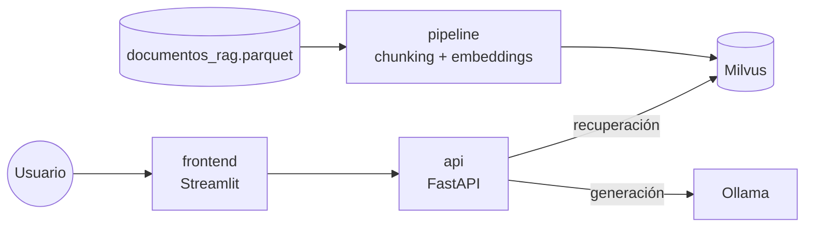

# Asistente RAG con Milvus y LLM locales

Asistente de preguntas y respuestas con generación aumentada por recuperación (RAG) sobre un corpus de prensa digital y publicaciones de Bluesky. Los fragmentos relevantes se recuperan en Milvus y la respuesta la genera un LLM local servido por Ollama, al que se le pide citar la evidencia que usa. Todo corre en Docker Compose, sin APIs de pago.

Proyecto académico de la Maestría en Inteligencia Artificial, Pontificia Universidad Javeriana.

## Arquitectura



| Servicio | Rol | Puerto local |
|---|---|---|
| `milvus` | Base de datos vectorial (standalone). WebUI en `/webui` | 19530, 9091 |
| `etcd`, `minio` | Metadatos y almacenamiento de objetos de Milvus. Consola de MinIO en 9001 | 9001 |
| `attu` | Interfaz para inspeccionar colecciones de Milvus | 3000 |
| `ollama` | LLM locales | 11434 |
| `api` | FastAPI: recuperación y generación | 8000 |
| `frontend` | Interfaz Streamlit | 8501 |
| `pipeline` | Trabajos batch (descarga, ingesta, pruebas). Perfil `tools`: no arranca con `up` | — |

`docker-compose.yml` solo incluye los archivos de `docker/`, uno por conjunto de servicios: `milvus.yml` (milvus, etcd, minio, attu), `ollama.yml`, `api.yml`, `frontend.yml` y `pipeline.yml`. Cada servicio propio tiene su Dockerfile en `docker/` y su lista de dependencias en `requirements/`.

El encoder (`intfloat/multilingual-e5-small` por defecto) se carga desde un único módulo, `app/embeddings.py`, que usan tanto `api` como `pipeline`. Ambos servicios comparten el volumen `hf_cache` con los pesos del modelo, así que las consultas y los pasajes se codifican exactamente igual.

## Requisitos

- Docker Engine con Compose 2.20 o superior (por `include`).
- RAM: se recomiendan 16 GB para la pila completa. Depende del LLM elegido.
- Disco: unos 20 GB para imágenes, modelos y datos (medido en macOS con Apple Silicon y `qwen2.5:1.5b`).

## Puesta en marcha

```bash
cp .env.example .env
docker compose up -d --build

# Corpus: descarga, verifica el sha256 y no sobrescribe sin --force
docker compose --profile tools run --rm pipeline python -m scripts.download_corpus

# LLM por defecto
docker compose exec ollama ollama pull qwen2.5:1.5b

# Ingesta piloto en Milvus (primeros 500 documentos)
docker compose --profile tools run --rm pipeline python -m scripts.ingest --input data/documentos_rag.parquet --limit 500
```

Después:

- Interfaz: http://localhost:8501
- Documentación de la API: http://localhost:8000/docs
- Attu: http://localhost:3000. Conectar a `milvus:19530`, sin usuario ni contraseña.
- WebUI de Milvus: http://localhost:9091/webui/

## Configuración

Las variables se leen de `.env` (plantilla en `.env.example`):

| Variable | Uso |
|---|---|
| `MILVUS_URI` | Dirección de Milvus |
| `MILVUS_COLLECTION` | Colección donde se indexa y se busca. El nombre identifica encoder y chunking, p. ej. `rag_e5small_char1000_v1` |
| `EMBEDDING_MODEL` | Modelo de Sentence Transformers |
| `EMBEDDING_QUERY_PREFIX`, `EMBEDDING_PASSAGE_PREFIX` | Prefijos de consulta y pasaje (`"query: "` y `"passage: "` para E5). Van entre comillas para conservar el espacio final |
| `EMBEDDING_NORMALIZE` | Normalización L2 de los vectores (`true` o `false`) |
| `OLLAMA_URL` | Dirección de Ollama |
| `MAX_CONTEXT_CHARS` | Máximo de caracteres de contexto que se envían al LLM |
| `LLM_MODEL` | Reservada. Hoy el modelo se elige en cada petición (`model`), con `qwen2.5:1.5b` por defecto |

Si cambia el encoder, sus prefijos, la normalización o la estrategia de chunking, los vectores dejan de ser comparables. En ese caso hay que usar otra colección y regenerar los embeddings; nunca se mezclan vectores de dos configuraciones en una colección.

## Pipeline

Los trabajos batch corren en el contenedor `pipeline`, que monta `./data`, `./reports` y `./configs`:

```bash
docker compose --profile tools run --rm pipeline python -m scripts.<tarea>
```

| Tarea | Qué hace |
|---|---|
| `download_corpus` | Descarga `dragons_rag` con `open_corpus_co_es`, verifica tamaño y sha256 contra el catálogo y lo copia sin modificar a `data/documentos_rag.parquet`. Opciones: `--output`, `--force` |
| `ingest` | Ingesta piloto: chunking por caracteres (1000 con solapamiento de 150), embeddings y `upsert` idempotente en Milvus. Opciones: `--limit`, `--chunk-size`, `--overlap`, `--batch-size` |

La ingesta necesita Milvus en marcha (`docker compose up -d`). El código va dentro de la imagen: después de cambiarlo hay que reconstruir con `docker compose --profile tools build pipeline`.

## API

| Método | Ruta | Descripción |
|---|---|---|
| `GET` | `/health` | Disponibilidad de la API (no comprueba Milvus ni Ollama) |
| `POST` | `/retrieve` | Fragmentos recuperados con su score y metadatos |
| `POST` | `/ask` | Respuesta del LLM, modelo, evidencia y latencia |

Cuerpo de `/retrieve` y `/ask`:

```json
{"query": "¿Qué señalan los documentos sobre el tema?", "model": "qwen2.5:1.5b", "k": 5, "temperature": 0.0}
```

`query` necesita al menos 3 caracteres, `k` va de 1 a 15 y `temperature` de 0 a 1. `/retrieve` ignora `model` y `temperature`. Cada fragmento de la evidencia trae `chunk_id`, `score`, `text`, `document_id`, `title`, `url`, `collection_name`, `source` y `position` (offset en caracteres sobre el texto original).

## Modelos LLM

```bash
docker compose exec ollama ollama pull llama3.2:1b   # también llama3.2:3b, gemma2:2b
docker compose exec ollama ollama list
docker compose exec ollama ollama rm <modelo>
```

El selector de la interfaz ofrece `qwen2.5:1.5b`, `llama3.2:1b`, `llama3.2:3b` y `gemma2:2b`. Si se pide un modelo que no se ha descargado, la API responde 503 con el 404 de Ollama en el detalle.

## Datos

El corpus es `dragons_rag` (versión 2026-10-19) del paquete [`open_corpus_co_es`](https://puj-nlp.github.io/open_corpus_co_es/). Según su catálogo tiene 169.248 documentos y 33 columnas: 64.670 publicaciones de Bluesky, 103.380 noticias de Media Cloud y 1.198 de GDELT. El script de descarga verifica el sha256 (`f4a669f1…b181728`) e informa el número de filas.

Reglas de datos:

- El corpus y sus derivados no se versionan. De `data/` solo se versionan `README.md` y las listas de IDs de `data/samples/`.
- `reports/` contiene solo agregados (conteos, percentiles, figuras): ni texto del corpus, ni handles de Bluesky, ni nombres de personas.
- El Parquet original nunca se modifica. Las limpiezas producen artefactos nuevos.
- Los campos de adquisición (palabras clave, `source`) describen cómo se recolectó el documento; no son etiquetas semánticas.

## Estructura

```
app/            servicios en línea: api.py, frontend.py, core.py (Milvus), embeddings.py (encoder)
pipeline/       lógica batch reutilizable y testeable
scripts/        CLI que se ejecutan en el contenedor pipeline (python -m scripts.<tarea>)
configs/        parámetros YAML de las etapas
docker/         compose por conjunto de servicios y un Dockerfile por servicio
requirements/   dependencias por imagen (api, frontend, pipeline, torch-cpu) y dev.txt para local
tests/          pruebas con pytest
data/           corpus y derivados (no se versiona, salvo samples/)
reports/        resultados agregados
docs/           protocolo de evaluación (EVALUACION.md)
```

## Desarrollo local y pruebas

```bash
# Pruebas en Docker (referencia)
docker compose --profile tools run --rm pipeline pytest -q

# Entorno local de exploración (Python 3.12, igual que las imágenes)
python3.12 -m venv .venv && source .venv/bin/activate
pip install -r requirements/dev.txt
pytest -q
```

El entorno local sirve para explorar. Toda cifra que se reporte sale de lo que corre en Docker.

## Estado actual y limitaciones

La infraestructura está lista: servicios separados en Docker, contenedor de pipeline, descarga verificada del corpus y encoder compartido entre API y pipeline. Lo que sigue es el perfilado y la calidad del corpus, el chunking por tokens, el ajuste de Milvus, la evaluación con un gold estándar propio y la comparación de al menos tres LLM. El protocolo de evaluación está en [`docs/EVALUACION.md`](docs/EVALUACION.md).

Limitaciones actuales:

- El chunking piloto es por caracteres; no tiene en cuenta el límite de 512 tokens del encoder.
- La colección usa `AUTOINDEX` con métrica coseno y guarda el texto de cada fragmento en Milvus.
- El contexto que se envía al LLM se recorta por caracteres, no por tokens.
- `/health` no comprueba las dependencias.
- La imagen de Ollama usa la etiqueta `latest`. Las demás imágenes de terceros tienen versión fija, pero aún sin digest.

## Uso responsable

- El corpus mezcla publicaciones en redes sociales y noticias. Hay que distinguir alegaciones, atribuciones y evidencia, y no equiparar cobertura con veracidad.
- Las respuestas del asistente deben contrastarse con las fuentes originales que cita.
- No se publican documentos del corpus ni datos personales en el repositorio.

## Reproducibilidad

Cada experimento debe registrar:

- el sha256 del Parquet;
- la semilla;
- la versión y el digest de las imágenes;
- el nombre, la versión, el hash y la cuantización de cada modelo;
- los parámetros de inferencia, el tamaño de chunk y `k`;
- los tiempos por etapa;
- el hardware.

Las muestras deben obtenerse con muestreo estratificado y semilla fija.

## Solución de problemas

| Síntoma | Causa y solución |
|---|---|
| `/ask` responde 503 con `404 Client Error ... /api/generate` | El modelo no está descargado en Ollama: `docker compose exec ollama ollama pull <modelo>` |
| `evidence` llega vacío | La colección de `MILVUS_COLLECTION` no existe o está vacía. Hay que ejecutar la ingesta o revisar el nombre en `.env` |
| El build falla con `No space left on device` | Falta espacio en la VM de Docker. Liberar la caché con `docker builder prune` |
| Un cambio en `pipeline/` o `scripts/` no se refleja | El código va dentro de la imagen: `docker compose --profile tools build pipeline` |

## Flujo de trabajo

- **`main`:** siempre funciona. Solo entra lo que construye, levanta y pasa las pruebas.
- **Ramas:** una rama corta por etapa (`feature/fase-0-fundaciones`, `feature/fase-a-perfilado`, …). El gold estándar avanza en paralelo en `feature/gold-estandar`.
- **Experimentos:** no van en ramas. Se parametrizan en `configs/` y sus resultados agregados van a `reports/`.
- **Integración:** cada rama entra por PR con merge commit (`--no-ff`). Cada hito lleva un tag (`fase-0`, `fase-a`, …, `entrega-final`).
- **Commits:** en formato Conventional Commits con descripción en español (`feat: …`, `fix: …`, `docs: …`, `test: …`).
